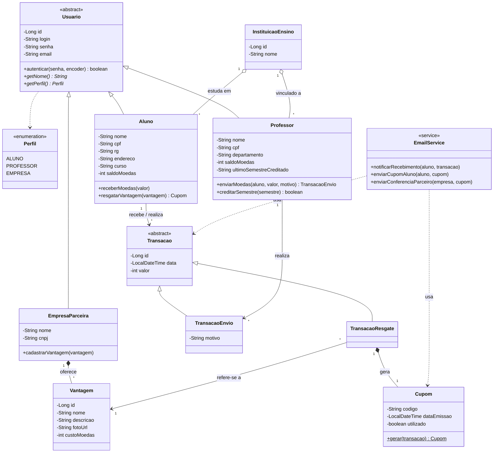
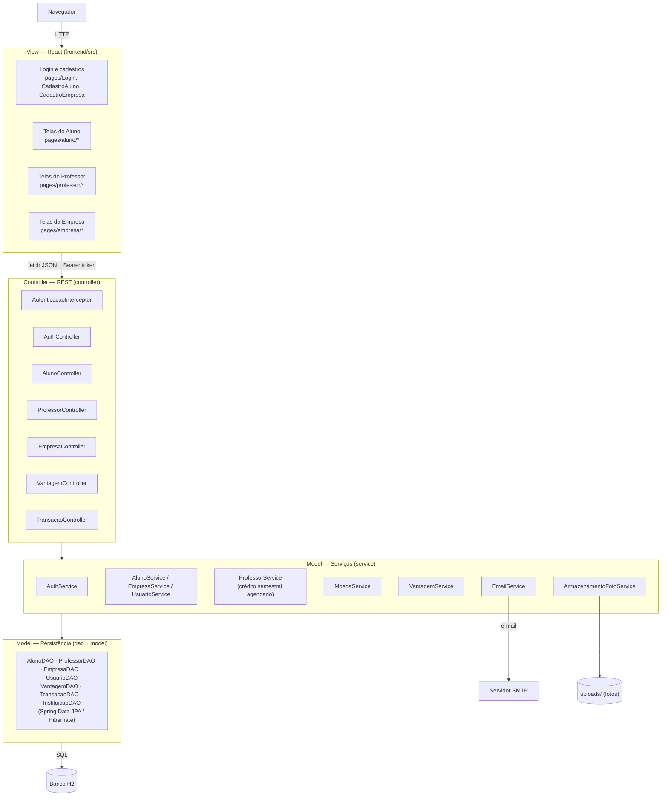

# Arquitetura e modelos — versão 2 (Lab03S03)

Os PDFs em `docs/` são a **versão 1** dos modelos (Lab03S01) e foram mantidos como histórico. Este documento
traz a **versão 2**, atualizada conforme a implementação final, e lista o que mudou.

## O que mudou da v1 para a v2

| Modelo | Alteração | Motivo |
|---|---|---|
| Classes | `Usuario.autenticar(senha, encoder)` recebe o codificador BCrypt; `Usuario` ganha `getPerfil()` e `getNome()` abstratos | A senha é guardada como hash; o perfil define as telas e permissões |
| Classes | `Professor.creditarSemestre(semestre)` e atributo `ultimoSemestreCreditado` | Garantir o crédito de 1.000 moedas uma única vez por semestre, de forma acumulativa |
| Classes | `Professor.enviarMoedas(...)` retorna `TransacaoEnvio`; `Aluno.resgatarVantagem(...)` retorna `Cupom` | As regras (saldo, motivo, mesma instituição) ficam no modelo; o serviço só persiste |
| Classes | `Vantagem.nome` | Título exibido no catálogo, além da descrição |
| Classes | `Cupom.gerar(transacao)` | Geração do código (formato `XXXX-XXXX`) |
| Componentes | View em **React** (SPA) no lugar de HTML/JS puro | Pedido da equipe para a Sprint 3 |
| Componentes | `ProfessorService`, `VantagemService`, `ArmazenamentoFotoService`, `AutenticacaoInterceptor` | Crédito semestral, CRUD de vantagens, upload de fotos e proteção da API |

## Diagrama de classes (v2)

## Diagrama de componentes (v2)

## Autenticação

1. `POST /api/auth/login` confere login e senha (`Usuario.autenticar`, BCrypt) e devolve um token aleatório.
2. O React guarda o token e o envia em `Authorization: Bearer <token>` em toda requisição.
3. `AutenticacaoInterceptor` valida o token em `/api/**` (exceto login, auto-cadastro e lista de instituições) e
   coloca o `UsuarioLogado` na requisição; os controllers verificam o perfil e se o recurso é do próprio usuário
   (401 sem login, 403 sem permissão).
4. As sessões ficam em memória e expiram em 8 h (`app.auth.validade-horas`).

## API REST

| Método | Rota | Quem | Descrição |
|---|---|---|---|
| POST | `/api/auth/login` | público | Login → `{ token, usuario }` |
| POST | `/api/auth/logout` | logado | Encerra a sessão |
| GET | `/api/auth/me` | logado | Usuário da sessão |
| GET | `/api/instituicoes` | público | Instituições pré-cadastradas |
| POST | `/api/alunos` | público | Cadastro de aluno |
| GET | `/api/alunos` | professor | Alunos da instituição do professor |
| GET/PUT/DELETE | `/api/alunos/{id}` | o próprio aluno | Consulta, edição e remoção |
| POST | `/api/empresas` | público | Cadastro de empresa |
| GET | `/api/empresas` | logado | Lista de empresas parceiras |
| GET/PUT/DELETE | `/api/empresas/{id}` | a própria empresa | Consulta, edição e remoção |
| GET | `/api/professores/{id}` | o próprio professor | Perfil (com a instituição) |
| GET | `/api/vantagens[?empresaId=]` | logado | Catálogo de vantagens |
| POST / PUT | `/api/vantagens[/{id}]` | empresa dona | multipart: `nome`, `descricao`, `custoMoedas`, `foto` |
| DELETE | `/api/vantagens/{id}` | empresa dona | Remove (se nunca resgatada) |
| POST | `/api/transacoes/envios` | professor | `{ alunoId, valor, motivo }` |
| POST | `/api/transacoes/resgates` | aluno | `{ vantagemId }` → transação com `cupomCodigo` |
| GET | `/api/transacoes/extrato` | aluno / professor | Saldo e transações |
| GET | `/api/transacoes/resgates` | empresa | Resgates das suas vantagens |
| POST | `/api/transacoes/cupons/{codigo}/confirmacao` | empresa | Registra o uso do cupom |
