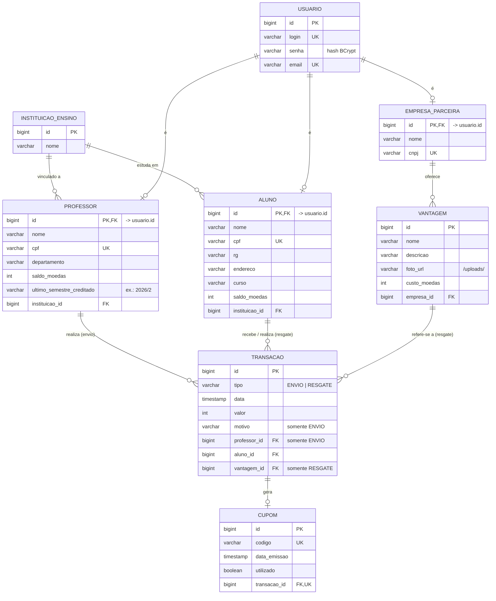

# Modelo ER e Estratégia de Persistência

> Atualizado no Lab03S03: colunas `vantagem.nome` e `professor.ultimo_semestre_creditado`
> (ver [Arquitetura.md](Arquitetura.md) para o histórico de mudanças dos modelos).

## Modelo Entidade-Relacionamento



### Mapeamento das heranças do diagrama de classes

| Hierarquia | Estratégia JPA | Justificativa |
|---|---|---|
| `Usuario` → `Aluno`, `Professor`, `EmpresaParceira` | `JOINED` (uma tabela por classe, PK compartilhada) | Os perfis têm atributos bem diferentes; evita muitas colunas nulas e mantém login/e-mail únicos em um só lugar. |
| `Transacao` → `TransacaoEnvio`, `TransacaoResgate` | `SINGLE_TABLE` (coluna discriminadora `tipo`) | As subclasses diferem em poucos campos; o extrato é uma consulta simples em uma única tabela. |

## Estratégia de acesso ao banco de dados

O sistema segue a arquitetura em camadas do [diagrama de componentes](Componentes.pdf):

```
View (React)  --HTTP/JSON-->  Controller  -->  Service  -->  DAO  -->  ORM (JPA/Hibernate)  -->  Banco
```

- **ORM: JPA com Hibernate** (via Spring Data JPA). As classes de `model` são entidades anotadas
  (`@Entity`) que espelham o diagrama de classes; o Hibernate gera o SQL e o esquema.
- **Padrão DAO**: cada agregado tem uma interface DAO (`AlunoDAO`, `EmpresaDAO`, `ProfessorDAO`,
  `VantagemDAO`, `TransacaoDAO`, ...) que estende `JpaRepository`. O Spring gera a implementação em
  tempo de execução, então os DAOs só declaram consultas específicas (`existsByCpf`, etc.).
  As camadas superiores nunca usam `EntityManager` nem SQL diretamente.
- **Services** concentram as regras de negócio e as transações (`@Transactional`): unicidade de
  login/e-mail/CPF/CNPJ, hash de senha (BCrypt), conversão entidade ↔ DTO.
- **Controllers** REST recebem/devolvem DTOs (`record`s), nunca as entidades, para não expor a senha
  e desacoplar a API do esquema.
- **Banco**: H2 em arquivo (`backend/data/`) no desenvolvimento, sem instalação. Para trocar por
  PostgreSQL/MySQL basta adicionar o driver e mudar `spring.datasource.*` em `application.properties`.
